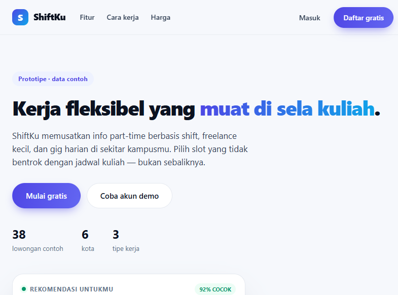
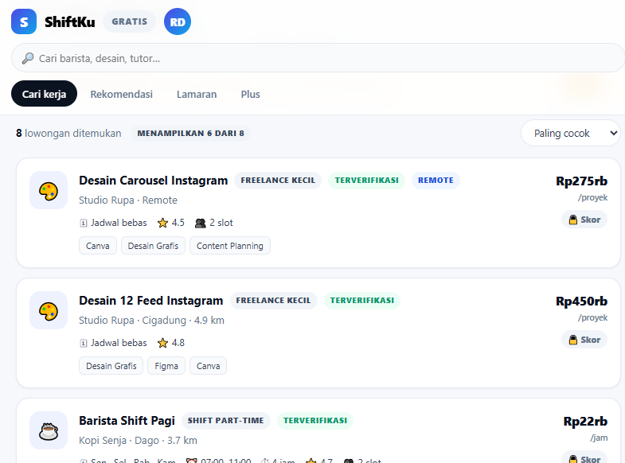
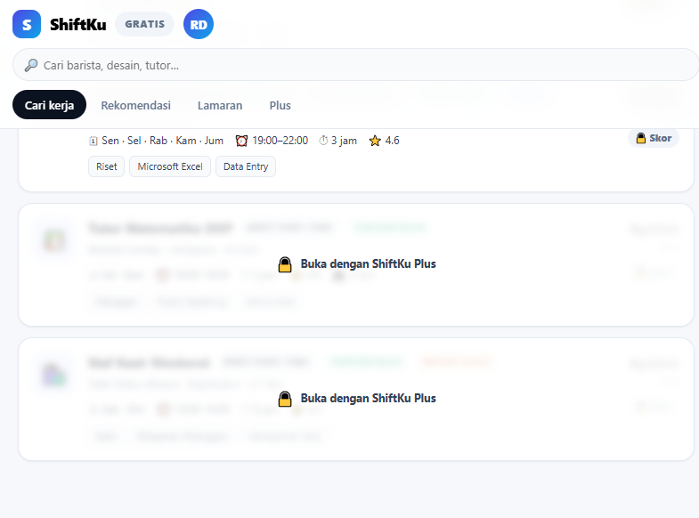
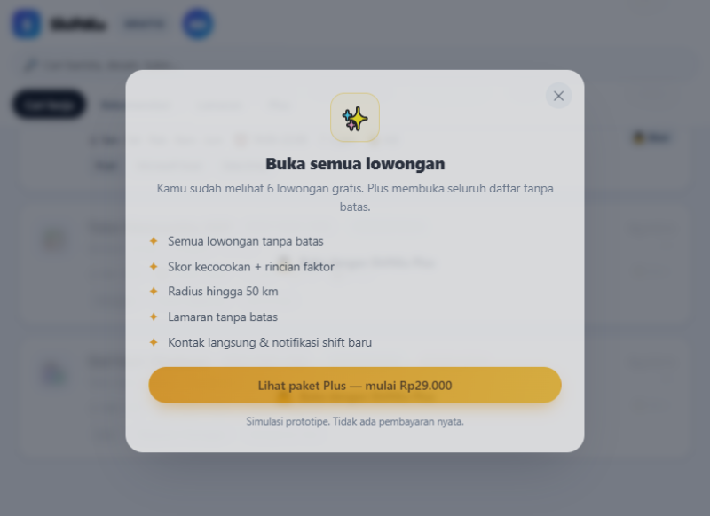
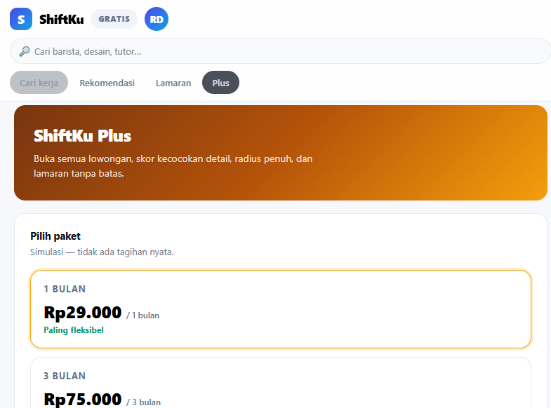
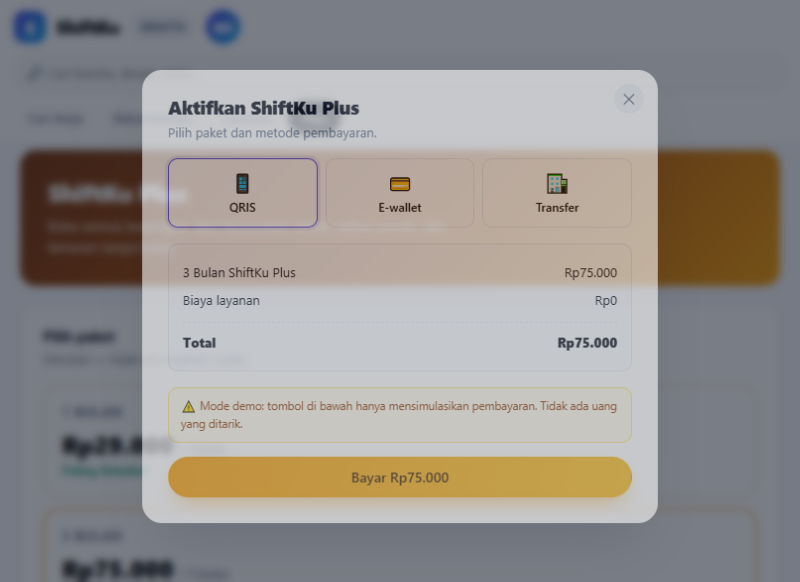
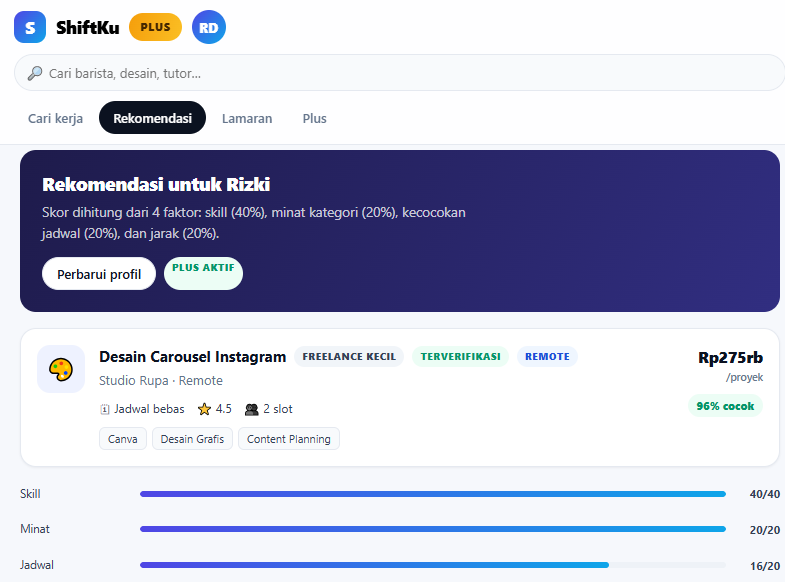
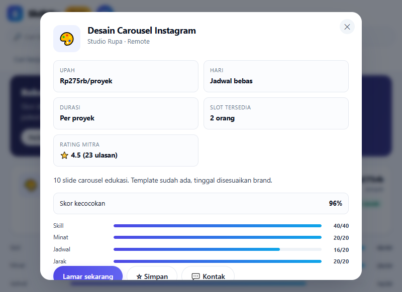

# Sifela.id — Prototipe Web

Prototipe antarmuka untuk **sifela.id**, platform kerja paruh waktu fleksibel berbasis shift
untuk mahasiswa sekaligus ruang pasang lowongan untuk pemilik usaha
(konsep #1 pada `persempitan-scope-5-konsep-bisnis.md`).

Isinya: pusat info **part-time berbasis shift**, **freelance kecil**, dan **gig harian**,
dengan pencarian, rekomendasi berbasis skor, filter wilayah/radius, deteksi bentrok jadwal,
serta dua jalur berbayar: **Sifela Plus** untuk pencari kerja dan **Mitra Pro** untuk pemilik usaha.

> ⚠️ **Ini prototipe.** Seluruh lowongan, organisasi, rating, dan ulasan adalah **data fiktif**.
> Tidak ada backend, tidak ada pembayaran nyata, dan tidak ada lowongan asli.



---

## Cara menjalankan

Tanpa build step, tanpa `npm install` — hanya HTML, CSS, dan JavaScript biasa.

**Pilihan 1 — paling cepat.** Buka `index.html` langsung di browser (dobel klik).
Semua skrip memakai `<script>` klasik, jadi tetap jalan dari `file://`.
Kalau browser memblokir `localStorage` untuk `file://`, pakai Pilihan 2.

**Pilihan 2 — server lokal (disarankan).**

```powershell
cd Rizki-1\sifela
python -m http.server 8099 --bind 127.0.0.1
```

Lalu buka <http://127.0.0.1:8099/>.

**Pilihan 3 — GitHub Pages.** Karena statis, folder ini bisa langsung dijadikan situs
GitHub Pages (set source ke root repo, buka `/Rizki-1/sifela/`).

**Pilihan 4 — Vercel.** Folder ini sudah memuat `vercel.json`, sehingga dapat langsung
dideploy sebagai situs statis:

1. Di dashboard Vercel, pilih **Add New → Project** lalu import repository GitHub ini.
2. Pada **Configure Project**, set **Root Directory** menjadi `Rizki-1/sifela`.
3. Biarkan **Framework Preset** pada *Other* / kosong, **Build Command** kosong, dan
   **Output Directory** pada akar folder tersebut.
4. Klik **Deploy**. Tidak ada variabel lingkungan yang diperlukan untuk prototipe ini.

Alternatif lewat CLI (setelah `vercel login`):

```powershell
cd Rizki-1\sifela
npx vercel --prod
```

---

## Akun demo

Akun dibuat otomatis di `localStorage` saat tombol demo diklik pertama kali.

| Tombol | Email | Kata sandi | Paket |
|---|---|---|---|
| **Gratis** | `demo@sifela.id` | `demo1234` | Gratis |
| **Plus (aktif)** | `plus@sifela.id` | `demo1234` | Plus, 30 hari |
| **Mitra** | `mitra@sifela.id` | `demo1234` | Mitra Gratis + 1 lowongan contoh |

Tombol demo **selalu** mengembalikan akun ke paketnya semestinya, jadi aman dipakai
berulang kali setelah mencoba alur checkout.

Akun hasil registrasi sendiri juga tersimpan di browser yang sama.

**Reset data demo:** buka DevTools → Console, jalankan `localStorage.clear()`, lalu muat ulang.

---

## Fitur dan pembatasan

### Halaman depan

Menu utama berisi empat item: **Beranda**, **Akun & Profil**, **Untuk Perusahaan**, dan
**Cari Lowongan**. Halaman depan memakai tema gelap navy (sampled dari foto referensi) dan
tetap menampilkan **Paket dan Harga**—tanpa menu harga terpisah. Bagian **Cari Lowongan**
merangkum enam filter: pencarian, bidang, gaji, lokasi dan jarak, tempat kerja, serta jadwal.

Tombol **Buka Pembayaran Plus** langsung membuka halaman pembayaran tanpa perlu masuk lebih
dulu. Pengguna yang belum memiliki sesi mendapat akun tamu sementara; pembayaran tetap simulasi.

### Akses tamu dan akun

Menu **Cari Lowongan** langsung membuka hasil pencarian. Tanpa sesi, aplikasi memakai akun
tamu sementara (data tidak tersimpan sebagai akun tetap). Untuk menyimpan profil dan lamaran,
daftar atau masuk melalui menu **Akun & Profil**.

Tema gelap navy dipakai konsisten di halaman depan, pembayaran, pencarian, rekomendasi,
lamaran, profil, ruang mitra, autentikasi, modal, dan notifikasi. Bilah navigasi aplikasi
memuat **Beranda**, **Cari Lowongan**, **Rekomendasi**, **Lamaran**, **Akun & Profil**,
**Untuk Perusahaan**, dan **Plus**. Logo Sifela maupun item **Beranda** kembali ke halaman
depan; halaman pembayaran juga memuat tautan balik yang sama.

Halaman **Akun & Profil** dapat menyimpan data kerja: nama, telepon/WhatsApp, alamat,
bio singkat, kampus, pendidikan terakhir, kota, radius, ketersediaan, jenis pekerjaan,
target upah per jam, portofolio, tautan CV, berkas CV (maksimal 700 KB disimpan sebagai
data URL), serta riwayat pengalaman kerja (jabatan, organisasi, periode, jenis pekerjaan,
dan rincian tugas). Ringkasan data tersimpan ditampilkan langsung di halaman yang sama.

### Matriks fitur

| Fitur | Gratis | Plus |
|---|---|---|
| Pencarian kata kunci + filter kategori/tipe/hari/upah | ✅ | ✅ |
| Urutkan: paling cocok, terbaru, upah tertinggi, terdekat | ✅ | ✅ |
| Lowongan yang bisa dilihat | 6 pertama | semua |
| Skor kecocokan | persentase saja, rincian terkunci | persentase + rincian 4 faktor |
| Radius jangkauan | maks. 10 km | maks. 50 km |
| Lamaran | 3 per 30 hari | tanpa batas |
| Simpan lowongan | ✅ | ✅ |
| Kontak / chat mitra | ❌ | ✅ (simulasi) |
| Notifikasi shift baru | ❌ | ✅ (rencana) |
| Harga | Rp0 | Rp29.000 / 1 bulan<br>Rp75.000 / 3 bulan<br>Rp139.000 / 6 bulan |

### Sisi mitra / pemilik usaha

Pendaftaran menyediakan peran **Pencari kerja** atau **Pemilik usaha**. Mitra bisa
memasang lowongan gratis (maks. 2 aktif) lewat form di halaman **Mitra**: kategori, tipe,
kota/area, upah, hari, jam, skill, dan deskripsi. Lowongan yang diterbitkan langsung ikut
pencarian dan tersimpan di `localStorage` browser.

| Fitur mitra | Gratis | Mitra Pro |
|---|---|---|
| Lowongan aktif | 2 | 10 |
| Muncul di pencarian wilayah | ✅ | ✅ |
| Badge & urutan “Ditonjolkan” | ❌ | ✅ |
| Statistik dilihat / lamaran | terbatas | lengkap |
| Verifikasi mitra | standar | diprioritaskan |
| Harga | Rp0 | Rp49.000/blan · Rp129.000/3 bulan · Rp239.000/6 bulan |

### Pemicu paywall

Semua tombol di bawah membuka modal penawaran Plus, bukan diam-diam memblokir:

1. **Lowongan ke-7 dan seterusnya** — kartu diblur dengan overlay "Buka dengan Sifela Plus".
2. **Skor kecocokan** — pill "🔒 Skor" di kartu, tombol "Lihat skor kecocokan" di detail.
3. **Radius** — slider mentok di 10 km; muncul "3 lowongan di luar 10 km. Buka dengan Plus →".
4. **Kuota lamaran** — percobaan ke-4 dalam 30 hari memunculkan "Kuota lamaran habis".
5. **Kontak mitra** — tombol "💬 Kontak" hanya terbuka untuk Plus.
6. **Notifikasi shift** — disebut di daftar manfaat Plus.
7. **Kuota lowongan mitra** — form pasang lowongan ke-3 memunculkan penawaran Mitra Pro.
8. **Tonjolkan lowongan** — tombol "Tonjolkan" membuka penawaran Mitra Pro bagi pengguna Gratis.
9. **Statistik mitra** — ringkasan pembuka lowongan dibuka penuh di Mitra Pro.

Alur bayar: pilih paket → halaman pembayaran (QRIS / e-wallet / transfer) → "Bayar" →
halaman sukses → status **Plus** atau **Mitra Pro** aktif dan seluruh batas langsung terbuka.
Semua transaksi **simulasi**, tidak ada uang yang ditarik dan tidak ada data pembayaran yang dikirim ke mana pun.

### Tampilan pembatasan

| Daftar untuk pengguna Gratis | Kartu terkunci |
|---|---|
|  |  |

| Modal paywall | Halaman paket Plus |
|---|---|
|  |  |

| Simulasi checkout | Rekomendasi dengan skor |
|---|---|
|  |  |



---

## Cara skor kecocokan dihitung

Total 100 poin, dihitung ulang setiap kali filter atau profil berubah:

| Faktor | Bobot | Logika |
|---|---|---|
| Skill | 40 | proporsi skill lowongan yang ada di profilmu |
| Minat kategori | 20 | +20 kalau kategori lowongan ada di minatmu, +6 kalau tidak |
| Kecocokan jadwal | 20 | proporsi hari kerja lowongan yang tersedia di jadwalmu |
| Jarak | 20 | makin dekat makin tinggi; lowongan remote selalu penuh |

Selain skor, ada filter **"Sembunyikan yang bentrok"** yang membuang shift yang hari kerjanya
tidak ada di jadwalmu, serta **"Skor minimal 70%"** untuk hanya melihat lowongan yang benar-benar
sesuai profil — ini pembeda utama Sifela dibanding job board biasa.

---

## Wilayah dan radius

Jarak dihitung dengan rumus haversine dari pusat kota terpilih, lalu dibandingkan dengan
slider radius. Data contoh sengaja disebar dari pusat kota sampai pinggiran
(mis. Bandung: Dago ±3,7 km, Lembang ±11,7 km, Soreang ±16,4 km, Padalarang ±17,2 km),
supaya perbedaan batas 10 km (Gratis) dan 50 km (Plus) benar-benar terasa saat dicoba.

Lowongan **remote** selalu lolos filter radius, tetapi tetap disaring oleh kata kunci,
kategori, tipe, dan hari.

---

## Struktur folder

```
Rizki-1/sifela/
├── index.html          # landing, form masuk/daftar, shell aplikasi, modal
├── assets/
│   ├── styles.css      # design system + responsive (1080 / 860 / 720 px)
│   ├── data.js         # 38 lowongan contoh, 6 kota, 10 kategori, 3 tipe, 25 skill
│   └── app.js          # auth & peran, onboarding, filter, skor, paywall, halaman bayar, lamaran, ruang mitra
└── docs/               # tangkapan layar untuk dokumentasi ini
```

### Mengubah data contoh

Semua data ada di `assets/data.js` (objek `SIFELA_DATA`). Untuk menambah lowongan,
salin satu objek di array `jobs` lalu ubah `id`, `title`, `org`, `cat`, `type`, `city`,
koordinat `lat`/`lng`, `pay`, `unit`, `days`, dan `skills`.

Setelah mengubah `data.js` atau `app.js`, naikkan angka `?v=` pada dua tag `<script>` di
`index.html` supaya browser tidak memakai cache lama.

---

## Batasan prototipe

- **Tanpa backend.** Semua akun, lamaran, dan status paket disimpan di `localStorage`
  browser masing-masing; tidak ada sinkronisasi antarperangkat.
- **Kata sandi tidak aman.** Hanya hash demo non-kriptografis (`hashPass`), bukan bcrypt/argon2.
  Jangan pernah dipakai untuk data nyata.
- **Pembayaran fiktif.** Tidak terhubung ke payment gateway; tidak ada validasi transaksi.
- **Data fiktif.** Nama mitra, rating, ulasan, dan gaji adalah karangan untuk demo.
- **Lowongan mitra lokal.** Posting lowongan tersimpan di browser yang sama; belum tersinkron ke akun lain atau server.
- **Verifikasi & pencairan upah** belum dibuat; badge terverifikasi pada data contoh hanya ilustrasi.
- **Notifikasi & chat** masih berupa tombol simulasi.

## Kaitan dengan dokumen konsep

Dokumen `persempitan-scope-5-konsep-bisnis.md` mengusulkan monetisasi lewat komisi per shift
terisi dan langganan UMKM. Prototipe ini menguji **satu opsi tambahan**: langganan opsional di
sisi mahasiswa (Plus), supaya mekanisme *gating* berbayar bisa didemokan tanpa harus
membangun dua sisi marketplace. Fitur inti — pencarian shift, deteksi bentrok jadwal, dan
lamaran — tetap gratis.
